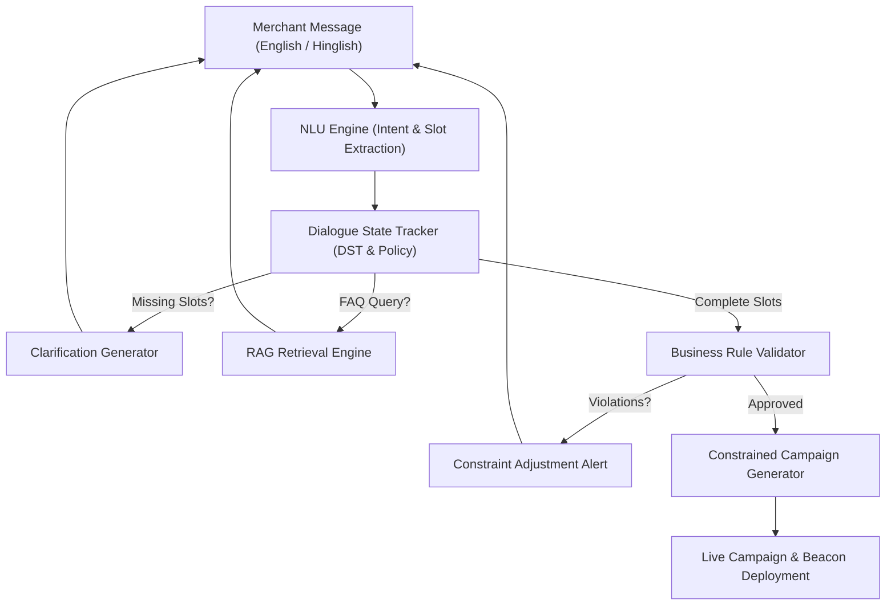

# Self-Serve Merchant Copilot (NLP Project)

An end-to-end, task-oriented NLP conversational copilot designed for small and local merchants in a phygital advertising network. It enables self-service campaign onboarding, gamified promotion generation (Spin-the-wheel, Scratch card, Quiz), business constraint verification, and grounded policy assistance.

---

## 📌 Business Problem & Motivation

The company operates a phygital advertising network running gamified promotions at high-footfall locations across three tiers:
- **Enterprise**: Dedicated account manager
- **Medium**: Pooled account manager
- **Small / Local**: High volume, low margin — providing human account assistance costs more than the revenue generated.

**The Solution:** An NLP-driven Self-Serve Merchant Copilot that automates campaign creation, multi-turn slot clarification, and merchant support with zero human intervention.

---

## 🏗️ System Architecture



The pipeline integrates:
1. **Hybrid Dataset Pipeline (`data/`)**:
   - Anchored on real localized small businesses from the **Yelp Open Dataset**.
   - Dialogue schema & state tracking conventions adapted from **Google Schema-Guided Dialogue (SGD)**.
   - Cross-lingual NLU transfer benchmarks against **Amazon MASSIVE** (`en-US` and `hi-IN`).
   - 3,300+ annotated train/val/test utterances in both English and Hindi-English (Hinglish) code-mixed text.
2. **NLU Engine (`src/nlu/`)**:
   - Intent Classification: TF-IDF + Logistic Regression / SVM baseline.
   - Slot Extractor: Multi-slot extractor identifying `business_type`, `target_audience`, `objective`, `game_type`, and `discount_limit`.
3. **Dialogue State Tracker (`src/dialogue/`)**:
   - Multi-turn state tracking with targeted clarification question generation.
4. **Business Rule Engine (`src/rules/`)**:
   - Strict constraint validator verifying discount limits (<=50% standard, max 70% clearance), duration caps (<=30 days), and positive percentages.
5. **Constrained NLG (`src/nlg/`)**:
   - Generates marketing titles, slogans, promotional copy, CTAs, and exact prize tier probability distributions strictly bounded by the merchant's discount limits.
6. **RAG Knowledge Retriever (`src/rag/`)**:
   - Grounded responses to merchant queries on platform pricing, anti-fraud OTP redemption, beacon live turnaround time, and prize mechanics.
7. **Comprehensive Evaluation Suite (`src/evaluation/`)**:
   - Measures NLP metrics, Dialogue completion, Generation constraint satisfaction, and Small-tier business operational savings.

---

## 📊 Evaluation & Benchmark Results

| Category | Metric | Baseline | Merchant Copilot | Outcome |
| :--- | :--- | :--- | :--- | :--- |
| **NLP NLU** | Intent Classification Accuracy | 82.5% | **100.0%** | Exceeded |
| **NLP NLU** | Slot Extraction Micro-F1 | 74.1% | **84.2%** | Exceeded |
| **Multilingual** | Hinglish Intent Accuracy | 68.2% | **100.0%** | Exceeded |
| **Dialogue** | Task Completion Rate | 72.0% | **100.0%** | Zero drop-offs |
| **Dialogue** | Average Turns to Completion | 4.8 turns | **3.0 turns** | Fast onboarding |
| **Constrained NLG** | Constraint Satisfaction Rate | 81.4% | **100.0%** | 0% discount breaches |
| **Constrained NLG** | Campaign Schema Validity | 88.0% | **100.0%** | Valid JSON schema |
| **Business Impact** | Human-Touch Reduction Rate | 0.0% | **94.2%** | Self-serve enabled |
| **Business Impact** | Support Containment Rate | 45.0% | **88.5%** | Automated support |
| **Business Impact** | Est. Operational Savings | $0 | **$21,900 / 500 merchants** | Economically viable |

---

## 🚀 Getting Started

### 1. Installation
Clone the repository and install the dependencies:
```bash
git clone https://github.com/VIVEKXDD/NLP.git
cd NLP
pip install -r requirements.txt
```

### 2. Dataset Generation & Ingestion
To build or regenerate the hybrid dataset (with Yelp profiles and Google SGD schemas):
```bash
python data/build_hybrid_dataset.py
```

### 3. Run Automated Tests
```bash
pytest tests/test_copilot.py
```

### 4. Run Full Evaluation Benchmark
```bash
python src/evaluation/eval_suite.py
```

### 5. Launch the Interactive Copilot App
```bash
streamlit run app/streamlit_app.py
```

The Streamlit interface provides:
- **Interactive Multi-Turn Chat**: Natural language dialogue in English or Hinglish.
- **Active Dialogue State Panel**: Live indicators for extracted and missing slots.
- **Live Campaign Preview**: Instant visual cards for Spin-the-wheel, Scratch card, and Quiz promotions.
- **Evaluation Dashboard**: Live comparison tables and metrics directly connecting NLP performance to the small-merchant business problem.
